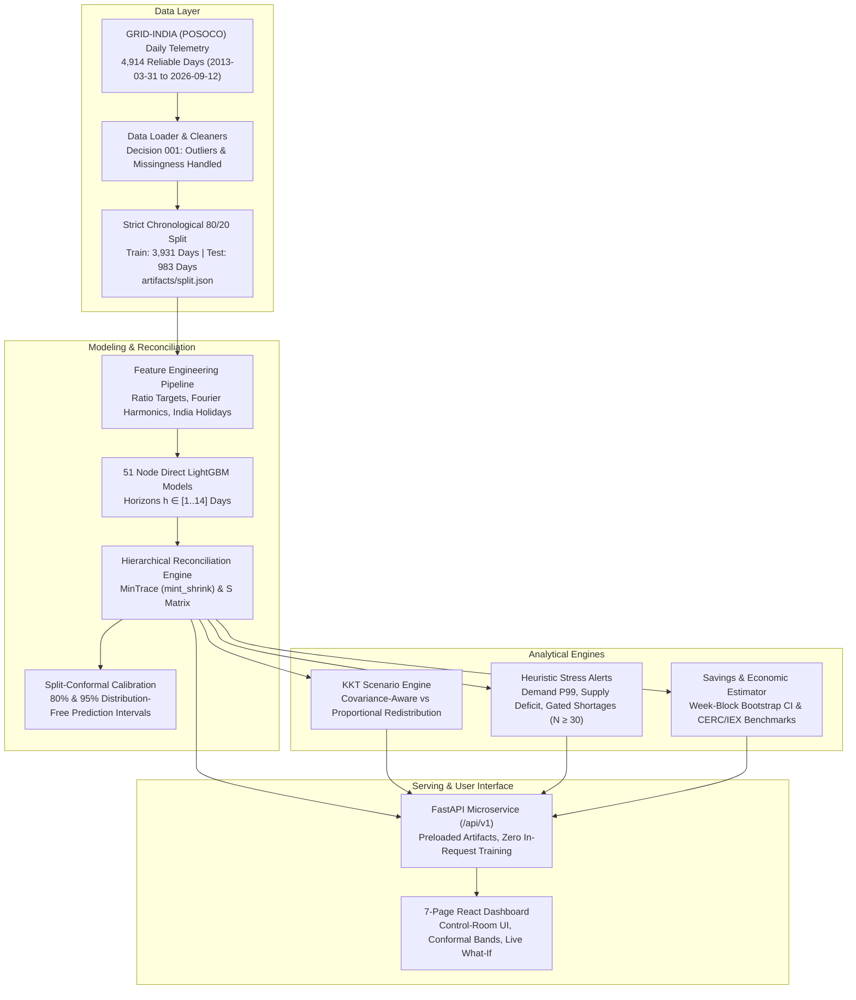

# TerraWatt v2
### Production-Grade Hierarchical Energy Demand Forecasting, Coherent Reconciliation & Grid Stress Engine

[](https://github.com/terrawatt-ai/terrawatt/actions/workflows/ci.yml)
[](https://creativecommons.org/licenses/by/4.0/)
[](https://python.org)
[](https://fastapi.tiangolo.com)
[](https://react.dev)

> **TerraWatt v2** is an end-to-end machine learning system predicting daily electricity demand across India's complete 3-level grid hierarchy: **45 bottom states/residuals → 5 Regional Load Despatch Centres (NR, WR, SR, ER, NER) → National Total**.
>
> Using **Minimum Trace (MinTrace) reconciliation with shrinkage error covariance**, TerraWatt eliminates the internal desk-to-desk planning discrepancies produced by independent models, enforcing **exact mathematical additivity down to machine precision ($< 10^{-12}$ MU/day)** across 14 forecast horizons while generating distribution-free **split-conformal prediction intervals**.
>
> Includes a **Covariance-Aware What-If Scenario Engine**, **Heuristic Grid Stress Indicators**, a **Bootstrap Avoided Mismatch Estimator**, a **FastAPI Microservice**, and a **7-Page Control-Room Dashboard**.

---

## 1. Verified System Metrics (Holdout Test Set)

> [!IMPORTANT]
> **Zero Data Leakage:** All metrics are evaluated strictly on the frozen 20% chronological holdout test set (**983 days: 2024-01-04 to 2026-09-12**) using models trained solely on the preceding 80% development set (**2013-03-31 to 2024-01-03**). Every figure is generated directly from reproducible repository artifacts.

| Metric | Measured Value | Benchmark / Baseline | Engineering Significance |
| :--- | :--- | :--- | :--- |
| **Mathematical Coherence** | **$< 10^{-12}$ MU** | Reconciled vs Regional Sum | Exact linear aggregation ($y = S b$) verified across all 14 horizons |
| **National Day-Ahead WAPE ($h=1$)** | **2.09%** (MAE: 99.81 MU/day) | 2.85% Unreconciled / 3.12% Seasonal Naive | **26.7% error reduction** over independent desk models |
| **Regional Day-Ahead WAPE ($h=1$)** | **3.26%** (MAE: 31.21 MU/day) | 3.66% Unreconciled Base | Preserves regional accuracy without distorting transmission-constrained grids |
| **Avoided Mismatch vs. Base** | **6,911.5 MU/year** | 10.82% lower physical mismatch | Evaluated over 983 test days across all 5 electrical regions |
| **95% Bootstrap Confidence Interval** | **[5,507.3, 8,209.4] MU/year** | 141 weekly blocks $\times$ 1,000 resamples | Robust to temporal autocorrelation in grid errors |
| **Base Economic Avoided Cost** | **₹3,078.48 Crore/year** | CERC DSM Cap (₹6.50) / IEX DAM (₹3.20) | Conservative valuation of avoided volumetric procurement error |
| **Desk Planning Inconsistency** | **91.03 MU/day** (33,249.8 MU/year) | Reported strictly separately | Pre-reconciliation discrepancy between national desk and regional sums |
| **Conformal Coverage (Nominal 95%)** | **88.0% – 88.8%** | Out-of-fold calibration | Distribution-free uncertainty bounds across multi-day horizons |

---

## 2. System Architecture



---

## 3. Repository Structure

```text
terrawatt/
├── .github/workflows/ci.yml       # GitHub Actions: Ruff, Pytest, Frontend Build, Docker Build
├── Dockerfile.api                  # Production container for FastAPI backend (OpenMP enabled)
├── Dockerfile.frontend             # Multi-stage container serving React frontend via Nginx
├── docker-compose.yml              # Local orchestration connecting API (8000) and Frontend (3000)
├── nginx.conf                      # High-performance Nginx config with API reverse proxy & SPA routing
├── .env.example                    # Environment configuration template
├── requirements.txt                # Pinned backend dependencies
├── docs/                           # Consolidated System & Design Documentation
│   ├── architecture.md             # Complete technical architecture & pipeline specification
│   ├── usability-notes.md          # Control room UX audit & Nielsen Norman evaluation
│   ├── DECISIONS.md                # Formal architectural decisions log (Decisions 001 - 012)
│   ├── MODEL_CARD.md               # Model provenance, metrics tables, and conformal coverage
│   ├── data_dictionary.md          # Column definitions, units, missingness, and supply audits
│   └── screenshots/                # Responsive layout & theme visual verification captures
│
├── api/                            # FastAPI Microservice (Port 8000)
│   ├── main.py                     # Versioned endpoints (/api/v1), CORS, request logging
│   ├── model_service.py            # Startup artifact preloader, zero in-request training
│   └── schemas.py                  # Pydantic v2 validation contracts
│
├── src/                            # Core Forecasting & Reconciliation Engine
│   ├── split.py                    # Chronological 80/20 data partitioning
│   ├── hierarchy.py                # 51-node hierarchy definitions and summing matrix S
│   ├── features.py                 # Multi-horizon feature extraction & ratio-target transformations
│   ├── models.py                   # Direct LightGBM regressors with non-negative constraints
│   ├── conformal.py                # Split-conformal prediction intervals
│   ├── scenario.py                 # KKT quadratic programming scenario engine
│   ├── alerts.py                   # Heuristic stress indicator engine with sample gating
│   └── savings.py                  # Block bootstrap avoided mismatch & economic valuation
│
├── scripts/                        # Reproducible Tooling & Monitoring
│   ├── cli.py                      # Seed-pinned CLI (train, evaluate, export)
│   ├── drift_check.py              # Rolling error and telemetry staleness detector
│   └── audit_columns.py            # Phase A POSOCO data audit script
│
├── tests/                          # 48 Automated Pytest Suites
│   ├── test_split.py               # Zero test-date leakage assertions
│   ├── test_reconciliation_coherence.py # Machine-precision additivity checks (< 1e-12 MU)
│   ├── test_scenario.py            # KKT equality constraints & pinned node tests
│   ├── test_alerts.py              # Stress alert thresholds & sample size gating tests
│   ├── test_savings.py             # Bootstrap CI & rupee valuation tests
│   └── test_api.py                 # FastAPI endpoint test client suites
│
└── frontend/                       # React 19 + TypeScript Strict + Vite Control Room
    ├── src/
    │   ├── api/                    # Typed OpenAPI Client & TanStack Queries
    │   ├── app/                    # Shell with TopBar, Theme Switcher & Router
    │   ├── components/             # Primitives: Button, Stat, Panel, Select, Slider, Term, HelpDrawer
    │   ├── content/                # Grade-8 plain language copy & interactive Glossary
    │   ├── features/               # 3-Column Energy Flow Sankey, Node Panel, Replay Controls
    │   ├── lib/                    # Bookmarkable URL state sync, number & date formatters
    │   ├── pages/                  # 7 Redesigned Control-Room Pages
    │   │   ├── OverviewPage.tsx
    │   │   ├── ForecastPage.tsx
    │   │   ├── EnergyFlowPage.tsx
    │   │   ├── ScenarioSimulatorPage.tsx
    │   │   ├── BacktestPage.tsx
    │   │   ├── SavingsPage.tsx
    │   │   ├── MethodAndLimitsPage.tsx
    │   │   └── StyleGuidePage.tsx
    │   └── styles/                 # CSS Tokens (Charcoal, Forest, Safety/Electric Blue, Turf Green)
    └── package.json
```

---

## 4. Quickstart Guide

### Option A: Docker Compose (Recommended for Production)

Run the entire full-stack system with a single command:

```bash
# 1. Clone repository
git clone https://github.com/terrawatt-ai/terrawatt.git
cd terrawatt

# 2. Copy environment template
cp .env.example .env

# 3. Launch API and Frontend
docker compose up --build -d

# 4. Access interfaces:
# - Control-Room UI:  http://localhost:3000
# - API Swagger Docs: http://localhost:8000/docs
# - API Health:       http://localhost:8000/api/v1/health
```

### Option B: Local Development

#### 1. Backend Setup (FastAPI)
```bash
# Create and activate virtual environment
python3 -m venv venv
source venv/bin/activate

# Install dependencies
pip install -r requirements.txt

# Run full test suite (48 tests)
export OMP_NUM_THREADS=1
export MPLCONFIGDIR=/tmp/mplconfig
pytest tests/ -v

# Start FastAPI microservice
uvicorn api.main:app --host 0.0.0.0 --port 8000 --reload
```

#### 2. Frontend Setup (React + Vite)
```bash
cd frontend
npm install
npm run build
npm run dev
# Open http://localhost:5173 in browser
```

---

## 5. Reproducible CLI & Drift Monitoring

TerraWatt includes a deterministic command-line interface with fixed seeds (`seed=42`):

```bash
# 1. Verify training pipeline and saved model artifacts
python scripts/cli.py train --seed 42

# 2. Evaluate model accuracy across all horizons and hierarchy levels
python scripts/cli.py evaluate --split artifacts/split.json

# 3. Export forecasts or economic savings
python scripts/cli.py export --type forecasts --output artifacts/metrics/exported_forecasts.csv
python scripts/cli.py export --type savings --output artifacts/metrics/exported_savings.json

# 4. Run operational drift and data staleness check
python scripts/drift_check.py --window 30 --threshold-wape 8.0
```

---

## 6. API Reference (`/api/v1`)

| Endpoint | Method | Description |
| :--- | :--- | :--- |
| `/api/v1/health` | `GET` | Service health status and version (`v2.0`). |
| `/api/v1/meta` | `GET` | Training dates, holdout cutoffs, library versions, git hash, and drift alerts. |
| `/api/v1/nodes` | `GET` | Full 51-node hierarchy tree, levels, parent-child links, and historical ranges. |
| `/api/v1/forecast` | `GET` | Multi-horizon forecast (1..14d) with 80% and 95% split-conformal intervals. |
| `/api/v1/hierarchy` | `GET` | Complete 3-level tree snapshot reporting real-time coherence gaps in MU/day. |
| `/api/v1/scenario` | `POST` | What-if simulation returning Covariance-Aware (KKT) and Proportional allocations. |
| `/api/v1/alerts` | `GET` | Evaluates 4 heuristic stress indicators (Demand, Supply, Shortage, Low Demand). |
| `/api/v1/backtest` | `GET` | Side-by-side actual vs. unreconciled vs. reconciled forecasts on holdout test set. |
| `/api/v1/metrics` | `GET` | Official frozen test set accuracy metrics by horizon and hierarchy level. |
| `/api/v1/savings` | `POST` | Avoided forecast mismatch (MU/yr), 95% bootstrap CI, and rupee valuations. |

---

## 7. Data Governance, Citation & Limitations

### Data Source Credits
Operational telemetry originates from daily reports published by:
* **Primary Authority:** Grid Controller of India Limited (GRID-INDIA, formerly POSOCO), National Load Despatch Centre (NLDC), New Delhi.
* **Compiler & Curator:** Compiled and maintained by **Robbie Andrew** (Senior Researcher, CICERO Center for International Climate Research) at [robbieandrew.github.io/india](https://robbieandrew.github.io/india/).
* **Scope:** 4,914 reliable daily records spanning **2013-03-31 to 2026-09-12**.

### Explicit System Limitations
* **No Sub-Hourly Dispatch:** TerraWatt models daily energy totals (`MU/day`). It does not model 15-minute scheduling time blocks, dynamic spinning reserves, or instantaneous grid frequency (50 Hz).
* **Statistical Redistribution, Not Power-Flow:** Scenario reallocations solve an equality-constrained quadratic program based on historical error covariance. They do not calculate AC/DC power flow, bus admittance matrices, or transmission line thermal limits.
* **Heuristics, Not Blackout Predictions:** Stress indicators evaluate historical statistical percentiles. They are operational screening heuristics, not deterministic outage predictors.
* **Avoided Mismatch, Not Treasury Savings:** Rupee valuations represent estimated reductions in volumetric procurement mismatch relative to stated mathematical baselines, not audited government balance sheet savings.

---

## 8. Professional Resume Summary

```text
TerraWatt v2 — Hierarchical Electricity Demand Forecasting & Grid Reconciliation Engine
• Engineered a production-grade 3-level hierarchical forecasting system for India's national electricity grid (45 states/residuals → 5 regions → 1 national total across 4,914 daily records).
• Eliminated desk-to-desk planning inconsistencies (91.03 MU/day pre-reconciliation gap) by implementing MinTrace (mint_shrink) reconciliation, guaranteeing exact mathematical coherence (< 10⁻¹² MU error) across 14-day horizons.
• Reduced National Day-Ahead forecast error (WAPE) from 2.85% to 2.09% (MAE: 99.81 MU/day), outperforming seasonal naive benchmarks (3.12%) on a strictly frozen 983-day chronological holdout test set with zero test-date leakage.
• Developed a Covariance-Aware What-If Scenario Engine using KKT quadratic programming to realistically redistribute demand shocks while protecting transmission-constrained regional grids (e.g. NER) from artificial distortion.
• Built an Assumption-Driven Avoided Mismatch Estimator demonstrating 6,911.5 MU/year (10.82%) avoided procurement mismatch with a 95% week-block bootstrap confidence interval ([5,507.3, 8,209.4] MU/yr), valued at ₹3,078.48 Cr/yr against CERC/IEX price benchmarks.
• Deployed full stack as a Dockerized FastAPI microservice with Pydantic v2 schemas and a 7-page responsive React/Vite control-room dashboard, complete with GitHub Actions CI, automated drift monitoring, and 48 passing unit/integration tests.
```
