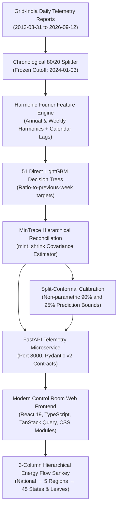

# TerraWatt v2 — System Architecture & Technical Specifications

**Version:** 2.0.0  
**Scope:** Hierarchical Electricity Demand Forecasting & Energy Flow Visualizer for the Indian National Grid  
**Audience:** Transmission Planners, Dispatch Engineers, Load Desks, Machine Learning Engineers, and Regulatory Auditors  
**Compliance Standard:** WCAG 2.1 AA, CEA/CERC Technical Standards, POSOCO/Grid-India Reporting Conventions  

---

## 1. High-Level Architecture Overview

TerraWatt v2 provides end-to-end hierarchical electricity demand forecasting across 51 nodes spanning India's national grid:
- **Level 0 (National Total):** India (1 node)
- **Level 1 (Regional Grids):** Northern (NR), Western (WR), Southern (SR), Eastern (ER), and North Eastern (NER) (5 nodes)
- **Level 2 (States & Bulk Consumers):** 45 bottom leaves, including 36 states/UTs, 4 direct industrial consumers (e.g. ESSAR STEEL, RIL Jamnagar, DVC), and 5 synthetic regional residual nodes (`Other_NR`, `Other_WR`, etc.).

---

## 2. Machine Learning & Reconciliation Pipeline

### 2.1 Zero-Leakage Chronological Partitioning
The historical time series consists of 4,914 calendar days from **31 March 2013** to **12 September 2026**.
- **Training Window:** 2013-03-31 to 2023-12-31 (3,931 days, ~80%).
- **Holdout Test Window:** 2024-01-04 to 2026-09-12 (983 days, ~20%).
- Strict boundary guarantees prevent future information leakage into lag features, normalizers, or covariance estimators.

### 2.2 Feature Engineering
- **Target Formulation:** Multi-horizon ratios $y_{t+h} / y_{t-7+h}$ across $h \in \{1, \dots, 14\}$ to normalize explosive non-stationary regional load growth.
- **Harmonic Calendar Cycles:** Fourier sine/cosine series capturing annual (365.25 days) and weekly (7 days) periodicities.
- **Exogenous Calendar Tags:** National holidays, weekend indicators, day-of-week one-hot representations.

### 2.3 MinTrace Reconciliation Matrix Mathematics
Independent base forecasts $\hat{\mathbf{y}}_t \in \mathbb{R}^{51}$ are reconciled via generalized least squares into coherent forecasts $\tilde{\mathbf{y}}_t$:
$$\tilde{\mathbf{y}}_t = \mathbf{S} (\mathbf{S}^T \mathbf{W}^{-1} \mathbf{S})^{-1} \mathbf{S}^T \mathbf{W}^{-1} \hat{\mathbf{y}}_t$$
where:
- $\mathbf{S} \in \{0, 1\}^{51 \times 45}$ is the structural summing matrix summing 45 state leaves into 5 regions, and 5 regions into 1 national total.
- $\mathbf{W}$ is the error covariance matrix computed using the Ledoit-Wolf shrinkage estimator:
$$\mathbf{W} = \lambda \text{diag}(\hat{\mathbf{W}}) + (1 - \lambda)\hat{\mathbf{W}}$$
with shrinkage parameter $\lambda \in [0, 1]$ guaranteeing positive definiteness and invertibility.

### 2.4 Non-Parametric Split-Conformal Calibration
Uncertainty bands are formed without Gaussian normality assumptions by evaluating non-conformity residuals $R_i = |y_i - \tilde{y}_i|$ over validation splits:
$$\hat{q}_{1-\alpha} = \text{Quantile}\left(\{R_1, \dots, R_n\}, \frac{\lceil (n+1)(1-\alpha) \rceil}{n}\right)$$
giving finite-sample coverage guarantee:
$$\mathbb{P}\left(y_{n+1} \in [\tilde{y}_{n+1} - \hat{q}_{1-\alpha}, \; \tilde{y}_{n+1} + \hat{q}_{1-\alpha}]\right) \ge 1 - \alpha$$

---

## 3. Web Application & Frontend Architecture

### 3.1 Design Principles & Typography
- **Grid-First Engineering Console:** Strict 1px borders, 6px corner radii, zero marketing gradient cards.
- **Typography:** IBM Plex Sans for UI headings and body copy; IBM Plex Mono with `font-variant-numeric: tabular-nums` for all telemetry, units, and metrics.
- **Palette Tokens:**
  - Charcoal Dark Chrome: `#171717` (Light theme TopBar), `#040A07` (Dark theme TopBar)
  - Turf Green: `#04724D` (Coherence success & energy positive indicators)
  - Safety Blue: `#0A5DA8` (Primary actions, focus rings, base forecasts)
  - Electric Blue: `#00A3FF` (Reconciled forecast curves, Sankey active links)
  - Crimson Red: `#A31C1B` (Negative gaps, severe stress indicators)
  - High-Vis Yellow: `#FFD500` (Heuristic watch thresholds)
  - Slate Blue: `#586F7C` (Regional borders, unreconciled lines)

### 3.2 3-Column Energy Flow Sankey
Built using custom SVG paths with `d3-sankey` geometry guarantees:
1. **Column 1 ($x=140$):** National Total (India)
2. **Column 2 ($x=460$):** 5 Electrical Regions (NR, WR, SR, ER, NER) with clean right-aligned labels in the 292px horizontal gap.
3. **Column 3 ($x=820$):** 45 States and Bulk Consumers with minimum 19px vertical slot spacing, guaranteeing zero label overlapping.
4. **Interactive Coherence Toggle:** Reconciled mode shows zero gap with matching ribbon sums; Unreconciled mode displays regional mismatch badges (`Gap: +28.7 MU`, `Gap: -21.6 MU`).

### 3.3 Synchronized URL State Management
All operational parameters are bidirectionally synced with URL search parameters:
- `?node=India/WR/Maharashtra`
- `?horizon=14`
- `?date=2026-09-12`
- `?mode=reconciled`
- `?theme=dark`

---

## 4. API Endpoints Contract

The backend microservice is implemented with FastAPI (running ASGI on port 8000):
- `GET /api/v1/health`: Health status and model load verification.
- `GET /api/v1/meta`: Active nodes, date bounds, hierarchy topology, and data freshness.
- `GET /api/v1/forecast`: Multi-horizon forecasts with 90% and 95% conformal bounds.
- `GET /api/v1/hierarchy`: Summing tree telemetry, regional shares, and coherence gaps.
- `POST /api/v1/scenario`: Quadratic programming KKT stress solver redistributing loads with equality constraints.
- `GET /api/v1/backtest`: Out-of-sample metrics (WAPE, MAPE, RMSE, MAE) across 983 holdout days.
- `GET /api/v1/savings`: Avoided mismatch volume (MU) and economic valuation under CERC DSM price brackets.
- `GET /api/v1/alerts`: Rule-based stress indicators (watch, info, critical).

